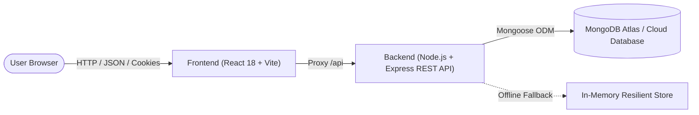

# SpendWise — Personal Expense Tracker, Budget Manager & Spending Insights

**SpendWise** is a full-stack personal finance web application developed for the **Full Stack Development – 2 (FSD-2)** laboratory examination. It enables students and individuals to record financial transactions, enforce monthly and category budgets, view financial insights via responsive charts, and securely manage their financial records.

---

## 🏛️ System Architecture

The application is architected as a decoupled client-server full-stack system:



- **Frontend (`/frontend`)**: React 18 (Functional Components, Hooks, React Router 6, Context API, responsive CSS3 design system, SVG charts, mobile navigation drawer).
- **Backend (`/backend`)**: Node.js & Express RESTful API, Express Router, session-based cookie authentication (`express-session`), bcrypt password hashing, input sanitization, and Mongoose ODM.
- **TypeScript Companion (`/typescript-companion`)**: Dedicated module demonstrating all prescribed FSD-2 TypeScript syllabus topics (Generics, Interfaces, Classes, Type Guards, and Enums).

---

## 🚀 Quick Start Guide

### Prerequisites
- **Node.js** (v18 or higher)
- **npm** (v9 or higher)

### 1. Start the Backend API Server
```bash
cd backend
npm install
npm start
```
> The Express server starts on **`http://localhost:5000`**.
> *Note:* If a MongoDB Atlas URI is not yet configured, SpendWise automatically activates an intelligent in-memory store pre-seeded with sample records so you can test every page and feature immediately!

### 2. Connect to MongoDB Atlas (Recommended for Viva)
1. Log in to [MongoDB Atlas](https://www.mongodb.com/atlas) and create a free M0 cluster.
2. In Database Access, create a user (e.g., `admin` / `<password>`).
3. In Network Access, allow access from anywhere (`0.0.0.0/0`).
4. Click **Connect** → **Drivers** → Copy connection string.
5. In `backend/.env`, set:
   ```env
   MONGODB_URI=mongodb+srv://<username>:<password>@cluster0.abcde.mongodb.net/spendwise?retryWrites=true&w=majority
   ```
6. Restart the backend server (`npm start`).

### 3. Start the Frontend Application
In a separate terminal:
```bash
cd frontend
npm install
npm run dev
```
> Open your browser at **`http://127.0.0.1:3000`**.

### 4. Run TypeScript Companion Practice Module
```bash
cd typescript-companion
npm install
npm run type-check
```

---

## 📱 Application Pages & Features

| Page | Route | Description & Features |
| :--- | :--- | :--- |
| **Landing Page** | `/` | Hero showcase, live dashboard preview card, feature highlights, and interactive FAQ. |
| **Registration** | `/register` | User signup with email validation, password strength meter, and password confirmation check. |
| **Sign In** | `/login` | Secure session login with **1-Click Instant Demo Login** for quick examiner evaluation. |
| **Dashboard** | `/dashboard` | Monthly income, expenses, net balance, remaining budget, SVG charts, and recent records. |
| **Transactions** | `/transactions` | Full searchable table with type & category filters, sorting, pagination, and CSV export. |
| **Budgets** | `/budgets` | Overall and category-specific monthly budgets with **80% warning** and **>100% exceeded alert**. |
| **Reports** | `/reports` | Month-over-month comparison (% changes), 6-month historical trend line chart, and category shares. |
| **Settings** | `/settings` | Profile editing, currency toggle (₹, $, €, £), **Theme Accent Switcher (Light Blue, Orange, Pink)**, Dark/Light mode, and Danger Zone. |
| **Custom 404** | `/*` | User-friendly 404 Not Found error page with navigation back to safety. |

---

## 🎨 UI Aesthetic & Theme Customization

SpendWise includes an accessible, modern theme customization system:
- **Default Aesthetic**: **Light Sky Blue** (`#0284c7`) with crisp contrast, airy glassmorphic cards, and soft ambient glows.
- **Alternative Accents**: Switchable with a single click to **Sunset Orange** (`#ea580c`) or **Blossom Pink** (`#db2777`) directly from the top navigation bar or **Settings**.
- **Dark & Light Modes**: Full dual-mode contrast support with WCAG AA compliance across all components.

---

## 📂 Laboratory Syllabus Directory (`/lab-experiments`)

All individual experiments strictly corresponding to the B.Tech CSE FSD-2 syllabus are organized in their own dedicated, standalone directory:
- `lab-experiments/01_nodejs/` — Units 1a, 1b, 1c, 1d, 1e
- `lab-experiments/02_typescript/` — Units 2a, 2b, 2c, 2d, 2e, 2f
- `lab-experiments/03_augmented/` — Units 3a, 3b, 3c
- `lab-experiments/04_express_routing/` — Units 4a, 4b, 4c
- `lab-experiments/05_express_templating/` — Units 5a, 5b
- `lab-experiments/06_express_auth/` — Units 6a, 6b
- `lab-experiments/07_express_db/` — Units 7a, 7b
- `lab-experiments/08_reactjs_basics/` — Units 8a, 8b, 8c
- `lab-experiments/09_reactjs_props_states_events/` — Units 9a, 9b, 9c
- `lab-experiments/10_reactjs_rendering_forms/` — Units 10a, 10b, 10c
- `lab-experiments/11_reactjs_router_screen/` — Units 11a, 11b
- `lab-experiments/12_reactjs_hooks_context/` — Units 12a, 12b
- `lab-experiments/13_reactjs_todo_app/` — Unit 13 (ReactJS To-Do Application)
- `lab-experiments/14_15_mongodb/` — Units 14a, 14b, 15a, 15b
- `lab-experiments/augmented_programs/` — Augmented (a: Node/Express Todo, b: React Quiz, c: MongoDB Certification)


---

## 🎓 FSD-2 Syllabus Concepts Demonstrated

### 1. React & Modern Frontend Architecture
- **Functional Components & JSX**: All pages and components are written with modular functional components.
- **React Hooks**:
  - `useState`: Manages local component states (modal visibility, form inputs, sorting preferences).
  - `useEffect`: Triggers data fetching upon month/filter changes and updates `document.title`.
  - `useContext`: Global state for authentication (`AuthContext`), theme/currency (`ThemeContext`), and notifications (`ToastContext`).
  - `useCallback`: Optimizes query functions across re-renders.
- **Client-Side Routing**: `react-router-dom` v6 with `ProtectedRoute` guards preserving session state.
- **Accessible & Responsive CSS3**: CSS Custom Properties (variables), mobile hamburger drawer, Flexbox/Grid, zero horizontal overflow (`overflow-x: hidden`).

### 2. Backend & Express RESTful API
- **RESTful Architecture**: Explicit endpoints for resources (`/api/auth`, `/api/transactions`, `/api/budgets`, `/api/reports`).
- **Express Router & Middleware**:
  - Chained validation middleware (`validateTransaction`, `validateRegistration`).
  - Session authentication guard (`requireAuth`).
  - Centralized 4-argument error handler (`errorHandler`) preventing sensitive stack trace leaks.
- **Security & Data Protection**:
  - Passwords hashed with `bcryptjs` using 10 salt rounds.
  - Stateful session cookies with `HttpOnly` and `SameSite` flags protecting against XSS and CSRF.
  - CSV Formula Injection prevention (cells starting with `=`, `+`, `-`, `@` are safely sanitized).

### 3. Database & Mongoose Modeling
- **Schemas & Data Types**: Typed definitions for `User`, `Transaction`, and `Budget`.
- **Validation**: Strict boundary rules (amounts > 0, valid email regex, valid YYYY-MM months).
- **Compound Indexes**:
  - `{ user: 1, date: -1 }` on `Transaction` for fast chronological queries.
  - `{ user: 1, month: 1, category: 1 }` with `{ unique: true }` on `Budget` to prevent duplicate active budgets.
- **Aggregation**: Calculation of totals and category breakdowns using `$match` and `$group`.

---

## 💡 College Lab Examination Viva Questions & Answers

### Q1: How does authentication work in SpendWise?
> **Answer:** SpendWise uses cookie-based session authentication with `express-session`. When a user logs in, their password is verified using `bcrypt.compare()`. Upon success, a session ID is stored in the session store (backed by MongoDB / memory) and sent to the client browser in an `HttpOnly` cookie. On subsequent requests, the `requireAuth` middleware verifies the cookie to identify `req.user`.

### Q2: How does SpendWise prevent CSV Formula Injection during export?
> **Answer:** In `transactionController.js`, user-controlled fields exported to CSV are passed through `sanitizeCsvField()`. If a cell starts with formula triggers such as `=`, `+`, `-`, or `@`, it is prefixed with a single quotation mark (`'`) and wrapped in escaped double quotes to prevent malicious spreadsheet execution.

### Q3: Why is `overflow-x: hidden` important for mobile optimization?
> **Answer:** On mobile viewports, unconstrained tables or grid margins can cause horizontal page scrolling, degrading user experience. Setting `overflow-x: hidden` on root containers and wrapping data tables inside `.table-container` with local scrolling ensures standard responsive behavior.

### Q4: How is the available balance calculated?
> **Answer:** The balance for any selected period is derived dynamically from stored transactions as `Total Income - Total Expenses`. It avoids static or hardcoded values.

---

## 📄 License & Academic Attribution
Developed for **Full Stack Development - 2 (FSD-2)** B.Tech CSE Coursework.
Designed for educational demonstration and real personal finance tracking.
